  

  <i>Hi, I'm <b>Lorenzo</b> — founder of <b>Prime Build</b>.</i> 
  I build custom PCs and software tools that make your hardware faster — and let you <b>make the most of it</b>. Everything on <a href="https://primebuild.website"><b>primebuild.website</b></a>.

---

## 🚀 What Prime Build does

Prime Build is PC consulting, assembly and repairs — gaming, workstation and office — with one goal:

> **Make every euro you spend become real performance.**

No brand-name parts just for the label, no "off-the-shelf" builds: only what your use case needs, tested and tuned. Plus PC and console repairs, targeted tweaks and overclocking.

And beyond building fast machines, I develop software tools that don't just speed up your hardware — they let you **make the most of what you have**: full control, visibility and optimization of everything your PC can really do.

| | |
|---|---|
| 🖥️ **PC Building** gaming · workstation · office | 🎯 **Consulting** maximum performance per euro spent |
| 🛠️ **Repairs** PCs and consoles, hardware and software | ⚡ **Tweaks & Overclocking** Windows tuning, stable OC, benchmarks |

---

## 📊 Stats & Languages

  
  

  

Percentages computed on public repos via the GitHub API. Live widgets: streak · activity graph.

---

## 🔥 Trending Projects

| Project | Description | |
|---|---|---|
| [**TweakHub**](https://github.com/PrimeBuild-pc/TweakHub) | All-in-one control center for Windows system tweaks |  |
| [**ThreadPilot**](https://github.com/PrimeBuild-pc/ThreadPilot) | Open-source Process Lasso alternative for Windows |  |
| [**ZapTweaks**](https://github.com/PrimeBuild-pc/ZapTweaks) | Windows 11 gaming optimizer |  |
| [**SockTuner**](https://github.com/PrimeBuild-pc/SockTuner) | Advanced network tuning & diagnostics |  |
| [**LightCrosshair**](https://github.com/PrimeBuild-pc/LightCrosshair) | Minimal customizable in-game crosshair |  |

  

### 📚 Technical guides
- [Complete NVIDIA DLSS 4.5 guide](https://github.com/PrimeBuild-pc/guida-completa-nvidia-dlss-4.5) — presets, quality, FPS
- [Low-latency gaming guide](https://github.com/PrimeBuild-pc/low-latency-gaming-guide) — network & system
- [Bufferbloat: LibreQoS vs Waveform](https://github.com/PrimeBuild-pc/bufferbloat-analysis) — comparative analysis

---

## 🧰 Stack & Tools

  
  
  
  
  
  
  
  

---

## 📬 Contacts

  
  
  
  

<b style="color:#ff6600">PRIME BUILD — build your dream.</b> 🔧

